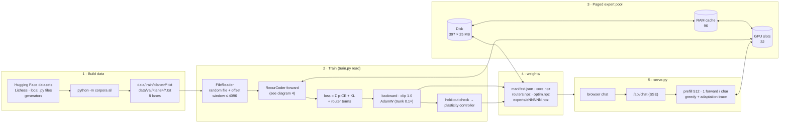
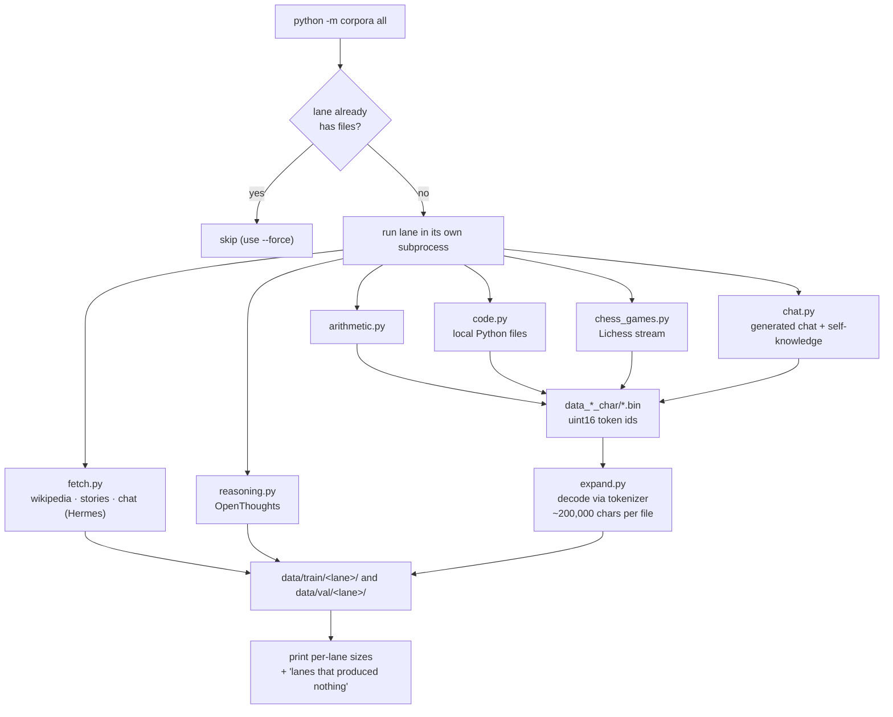
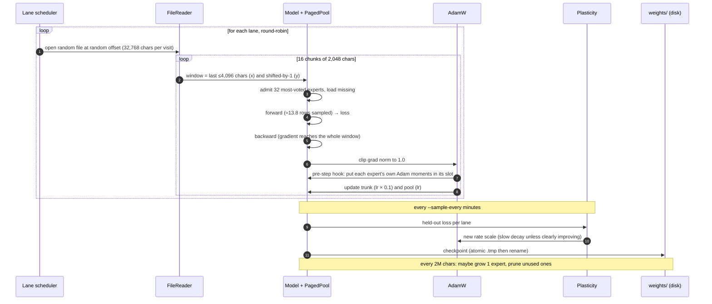
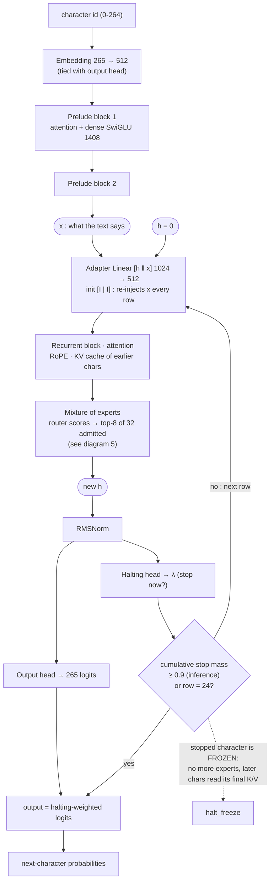
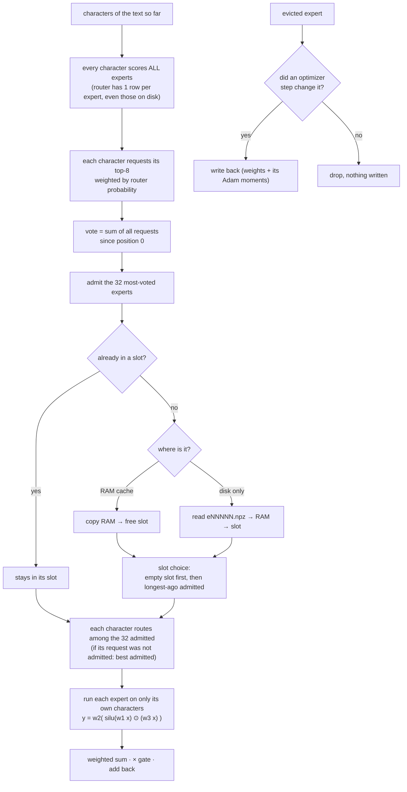
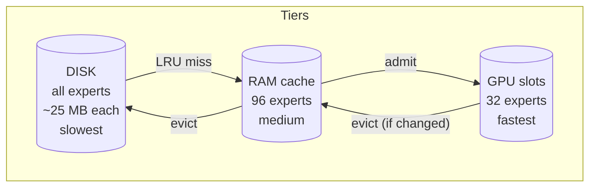
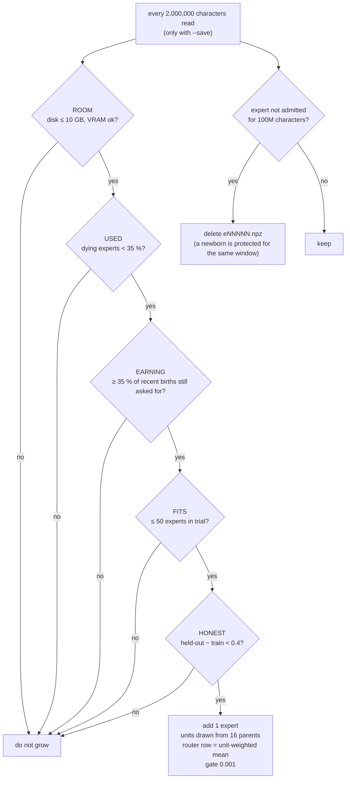
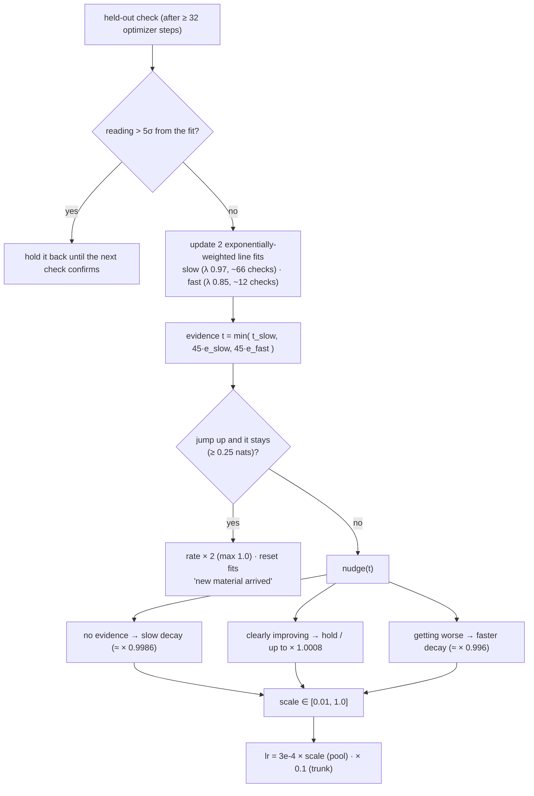
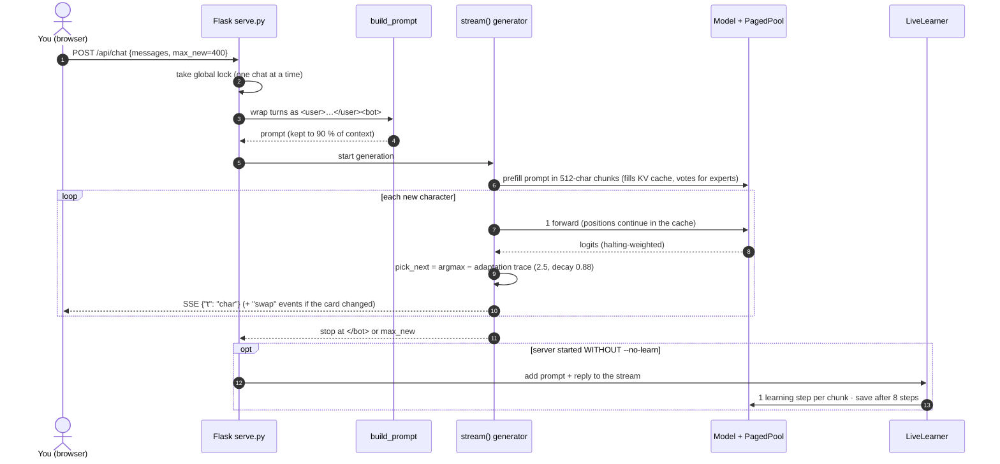
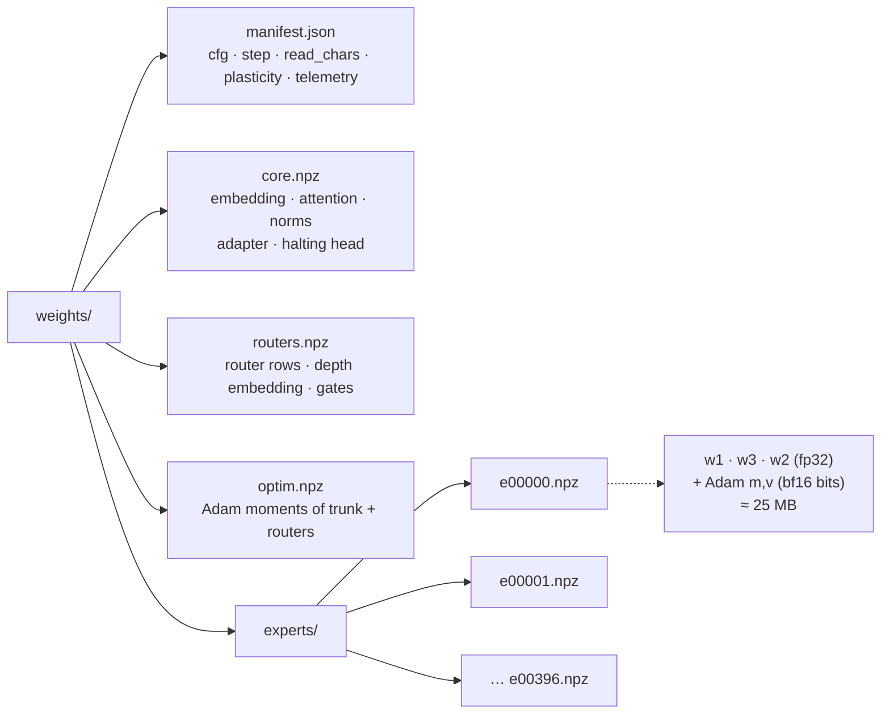

# mini-AGI – end-to-end diagrams (Mermaid)

Other diagram files in this folder:

| File | What it is |
|------|-----------|
| `architecture-interactive.html` | **Interactive page** – open it in any browser (no internet needed) |
| `architecture.excalidraw` | One big editable drawing – open at <https://excalidraw.com> (File → Open) |
| `architecture-preview.png` | A picture of the Excalidraw drawing |
| `interactive-overview-preview.png` | A picture of the interactive page's first tab |
| `png/` | The 10 Mermaid diagrams below, already rendered as PNG images |
| `diagrams.md` | This file: 9 focused diagrams (10 Mermaid blocks), one for each stage |

---

## 1. The whole system on one page

---

## 2. Building the data (`python -m corpora all`)

---

## 3. One training step (and the loop around it)

---

## 4. The model: one character, many rows

**Training loss:** `Σ_rows p_row · CE_row` + `0.01 · KL(p ‖ geometric prior 0.072)` + router auxiliary + balance term.
Training depth is sampled `Poisson(12.8) + 1` (clipped to 1…24).

---

## 5. Choosing and paging experts ("the text chooses")

---

## 6. Growing and pruning the pool

---

## 7. The learning-rate controller

---

## 8. Serving a chat reply

---

## 9. The `weights/` folder

