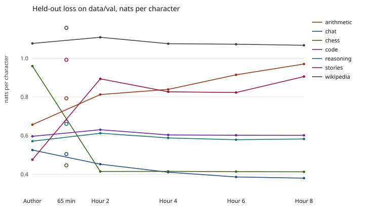

# Evaluation results

Measurements use commit `2eea41fcd83b3489df27f55de61bd1ecec8b33cb`. The protocol and the question files are commit `8085b11dfa2ed318ad56c080841cf2578ca85924`. The frozen Claude prompt is commit `57c3bc74ceb0ac8096b5c9634c90b2bd29b49b19`. Every benchmark record in `research/eval/benchmarks/` has `fresh: true`. The repeat of the author’s weights and of hour 8 moved by less than 0.0001 nats, under the 0.03-nat noise line.

The author’s `weights/manifest.json` was last written at 2026-10-12 15:55:31 -0700 and was unchanged after the measurements. The six `core.npz` hashes match `RESEARCH.md`.

Claude is `claude-opus-5-5`, effort `low`, with no temperature sent. All 900 replies, 400 questions in both conditions plus a 50-question re-run, stopped on `end_turn`. None were refusals and none hit the length limit, so every question is valid for the paired comparisons. The API key is only in the untracked `.env`.

## Closed-book

The model saw the question only. Cosine is to the official reference, after stripping the trained lead-in and cutting each text to that question’s cleaned reference. Qwen is `Qwen/Qwen3-Embedding-0.6B`. mpnet is `sentence-transformers/all-mpnet-base-v2`. Both texts were encoded with no instruction. Word F1 is the project’s function in `tools/csulb/eval.py`, on the raw answer before that stripping.

| | Author | Hour 8 | Claude |
|---|---:|---:|---:|
| Qwen cosine | 0.543 | 0.693 | 0.601 |
| mpnet cosine | 0.461 | 0.645 | 0.559 |
| Word F1 | 0.117 | 0.562 | 0.174 |
| Policy number | 22 / 279 | 112 / 279 | 32 / 279 |
| Date, date questions | 2 / 50 | 12 / 50 | 4 / 50 |
| Full URL | 0 / 400 | 174 / 400 | 0 / 400 |

A question with no policy number is left out of the number rate. Date is scored only when the kind is `date`. Every question has a URL.

Chance, the cosine to a different question’s reference over 10 shuffles, is 0.305 (Qwen) and 0.206 (mpnet) for the author, 0.374 and 0.259 for hour 8, and 0.366 and 0.259 for Claude. Each system’s cosine to the right reference sits above its own floor.

On the 400 paired questions, the bootstrap 95% intervals are:

| Contrast | Embedding | Mean gap | 95% interval |
|---|---|---:|---:|
| Hour 8 minus author | Qwen | 0.150 | 0.126 to 0.174 |
| Hour 8 minus author | mpnet | 0.184 | 0.157 to 0.212 |
| Hour 8 minus Claude | Qwen | 0.092 | 0.065 to 0.119 |
| Hour 8 minus Claude | mpnet | 0.086 | 0.053 to 0.119 |

Both embeddings rank hour 8, then Claude, then the author.

Agreement with Claude, the cosine between the two answers on the same question, is 0.538 (Qwen) and 0.458 (mpnet) for hour 8. Hour 8 is closer to the official reference (0.693) than to Claude. The ceiling, cosine between Claude’s two closed-book runs on the first 50 questions, is 0.896 (Qwen) and 0.887 (mpnet).

## Gold passage

The passage is the stored `passage` on the question, rendered once into `gold_user` when the sample was drawn. No search was used.

| | Author | Hour 8 | Claude |
|---|---:|---:|---:|
| Qwen cosine | 0.634 | 0.918 | 0.792 |
| mpnet cosine | 0.577 | 0.909 | 0.760 |
| Word F1 | 0.201 | 0.868 | 0.445 |
| Policy number | 25 / 279 | 236 / 279 | 278 / 279 |
| Date, date questions | 4 / 50 | 44 / 50 | 50 / 50 |
| Full URL | 0 / 400 | 353 / 400 | 79 / 400 |

On the same 400 questions:

| Contrast | Embedding | Mean gap | 95% interval |
|---|---|---:|---:|
| Hour 8 minus author | Qwen | 0.284 | 0.266 to 0.303 |
| Hour 8 minus author | mpnet | 0.332 | 0.310 to 0.353 |
| Hour 8 minus Claude | Qwen | 0.127 | 0.110 to 0.143 |
| Hour 8 minus Claude | mpnet | 0.149 | 0.128 to 0.170 |

Both embeddings rank hour 8, then Claude, then the author. The gold-passage ceiling on the 50 re-run questions is 0.954 (Qwen) and 0.938 (mpnet). Agreement between hour 8 and Claude is 0.765 (Qwen) and 0.726 (mpnet).

## By kind

Fifty questions of each kind. Closed-book Qwen cosine:

| Kind | Author | Hour 8 | Claude | Hour 8 word F1 |
|---|---:|---:|---:|---:|
| Topic | 0.407 | 0.458 | 0.563 | 0.345 |
| Overview | 0.480 | 0.587 | 0.615 | 0.387 |
| Where | 0.560 | 0.856 | 0.672 | 0.711 |
| Date | 0.483 | 0.629 | 0.534 | 0.527 |
| Number | 0.676 | 0.926 | 0.710 | 0.813 |
| Definition | 0.448 | 0.388 | 0.548 | 0.265 |
| Approval | 0.660 | 0.887 | 0.636 | 0.784 |
| Supersedes | 0.630 | 0.813 | 0.532 | 0.663 |

mpnet agrees on the direction from the author to hour 8 for every kind, including definition, where closed-book cosine falls (mpnet 0.368 to 0.293) while word F1 still rises (0.086 to 0.265). On definition, both embeddings place Claude above hour 8 (mpnet 0.567 against 0.293). The overall order remains hour 8, then Claude, then the author.

## Error panel

High cosine means the top quarter of cosine-to-reference for that system and that embedding. A tie at the cutoff stays in. For hour 8 closed-book the cutoff is a real quarter: 100 of 400. For hour 8 with the gold passage, Qwen’s 100th value is already 1.0, so every perfect match stays in and the panel has 142 rows. mpnet’s gold panel has 205 for the same reason.

Of the 36 hour-8 closed-book answers in the Qwen panel whose policy number or date is missing, 19 omit a number or date that the official reference itself contains. The other 17 are flagged because the stored document has a number and the reference sentence does not use it. All 21 rows in the hour-8 gold Qwen panel are that second kind. Claude’s closed-book Qwen panel flags 81 of 100, and 66 of those omit a fact the reference contains. Claude’s gold-passage panel flags none of its top 100.

## How the replies ended

The limit was 800 characters. `end_marker` means `serve.stream` finished the reply before that. `limit` means it used all 800.

| | Closed, end | Closed, limit | Gold, end | Gold, limit |
|---|---:|---:|---:|---:|
| Author | 204 | 196 | 266 | 134 |
| Hour 8 | 382 | 18 | 388 | 12 |

Every limit stop is exactly 800 characters. No saved answer still contains a chat marker.

## Demo

Closed-book. Several hour-8 answers tie at cosine 1.0 on both embeddings. The first of those, in question-file order within the tie, is `f01658`.

Question: Where is the official Department of Cinematic Arts posted?

Official reference: The official text of the Department of Cinematic Arts is published by the CSULB Academic Senate at https://www.csulb.edu/academic-senate/department-of-cinematic-arts

The stored policy record for that document has the same title and the same URL, and the passage says it was published by the CSULB Academic Senate. Policy Statement 23-21, dated October 27, 2023, is in the passage. This question’s reference sentence does not include the number or the date, and neither does the hour-8 answer.

Hour 8 repeats the reference exactly, word F1 1.0, and stops at 166 characters on the end marker.

The author’s weights answer: “1. Introduction: The Department of Cinematic Arts posted includes the formation of arts, cinematic posted arts, and cinematic posted arts.” It goes on in that pattern and does not give the URL.

Claude, with no passage, does not treat the question as CSULB. It says the question is ambiguous, mentions the University of New Mexico and the University of Southern California, and asks which institution is meant. It gives no CSULB URL.

Median hour-8 closed-book cosine is 0.735, question `f00208`, on the early-resolution section of the discrimination policy. The reference says the complainant should contact the Human Resources Manager. Hour 8 says the complainant should consult the Executive Director, and it cites an Associated Students URL. The cosine is high and the office is wrong. That is the backup example.

## Forgetting

Held-out loss is nats per character. The `data/val` line is the author’s seven subjects. The CSULB mix adds `csulb_qa` and `csulb_qa_open`, so its average is a different quantity and is not plotted on the same line. Hours 2, 4, 6, and 8 are one series, drawn from the author’s weights through those hours. The 65-minute checkpoint is a different run (ten subjects, learning rate `1e-4`, plasticity reset) and is the open circles on the chart.

`data/val`, mean of the seven subjects. The two repeats are shown as the second number.

| Checkpoint | Step | Loss |
|---|---:|---:|
| Author | 914,508 | 0.6945, repeat 0.6945 |
| 65 minutes | 923,915 | 0.7465 |
| Hour 2 | 950,140 | 0.7033 |
| Hour 4 | 965,184 | 0.6796 |
| Hour 6 | 982,163 | 0.6843 |
| Hour 8 | 995,953 | 0.7028, repeat 0.7028 |

Per subject on `data/val`:

| Subject | Author | 65 min | Hour 2 | Hour 4 | Hour 6 | Hour 8 |
|---|---:|---:|---:|---:|---:|---:|
| Arithmetic | 0.657 | 0.793 | 0.812 | 0.839 | 0.915 | 0.970 |
| Chat | 0.525 | 0.504 | 0.452 | 0.411 | 0.386 | 0.380 |
| Chess | 0.960 | 0.446 | 0.414 | 0.415 | 0.413 | 0.413 |
| Code | 0.596 | 0.672 | 0.630 | 0.604 | 0.602 | 0.601 |
| Reasoning | 0.571 | 0.660 | 0.612 | 0.588 | 0.578 | 0.583 |
| Stories | 0.476 | 0.992 | 0.894 | 0.827 | 0.823 | 0.905 |
| Wikipedia | 1.077 | 1.158 | 1.108 | 1.075 | 1.073 | 1.067 |

Arithmetic and stories are worse at hour 8 than on the author’s weights, by more than 0.03 nats. Chat and chess are better. Code, reasoning, and the project’s own Wikipedia held-out stay inside 0.03 nats.

On the CSULB mix, the two added subjects:

| Subject | Author | 65 min | Hour 2 | Hour 4 | Hour 6 | Hour 8 |
|---|---:|---:|---:|---:|---:|---:|
| csulb_qa | 0.802 | 0.389 | 0.143 | 0.099 | 0.082 | 0.081 |
| csulb_qa_open | 0.795 | 0.434 | 0.246 | 0.184 | 0.160 | 0.139 |

The mix mean goes from 0.7177 (repeat 0.7176) on the author’s weights to 0.5710 (repeat 0.5710) at hour 8. That drop is the CSULB subjects. The other seven move as in the table above.

enwik9, frozen, 2,000 pieces of 2,048 bytes, bits per byte:

| Checkpoint | Bits/byte |
|---|---:|
| Author | 1.3556, repeat 1.3556 |
| 65 minutes | 1.6284 |
| Hour 2 | 1.7790 |
| Hour 4 | 1.6980 |
| Hour 6 | 1.6984 |
| Hour 8 | 1.7359, repeat 1.7358 |

PG19, frozen, 100 books, 41,289,001 bytes scored, window 4,096:

| Checkpoint | Bits/byte | Nats/byte |
|---|---:|---:|
| Author | 2.0578, repeat 2.0577 | 1.4263 |
| 65 minutes | 2.2864 | 1.5848 |
| Hour 8 | 2.2141, repeat 2.2141 | 1.5347 |

Hour 8 is worse than the author’s weights on both published sets, by about 0.38 bits/byte on enwik9 and 0.11 nats/byte on PG19. Both gaps are larger than 0.03 nats.

## Earlier pilot

The original 60 questions, with a 360-character limit, stay a separate pilot. Eleven of them also sit in this 400. The sample was not redrawn. `runs/csulb_eval.md` reports closed-book word F1 of 13.4% on the author’s weights and 31.6% after the earlier continuation. `runs/csulb_8h_review.md` reports 41.9% closed-book word F1 at hour 8 on all 60. In that pilot every hour-8 answer stopped at 360 characters, so the URL rates there were partly lowered by the limit. The open-book numbers in those files used BM25. They are an earlier pilot. This run’s gold passage is the stored passage, and the closed-book numbers above use the 800-character limit.

## Methods

Only output paths and `--force` were added to `tools/measure_heldout.py`, `tools/measure_enwik9.py`, and `tools/eval_pg19.py`. With those flags omitted, each tool follows its previous path. The measurement arithmetic was not changed. Every call in this run passed `--force`, including the first measurement of `weights/`. `config.yaml` was not edited. `tools/refresh_readme.py` and `measure_benchmarks.sh` were not run.

Local answers use `serve.build_prompt` and `serve.stream` with learning off, the same call `eval.ask` makes, at temperature 0, with that function’s repetition guard. The gold-passage user text is the stored `gold_user` string.

Claude was asked one question at a time, with no history and no temperature. The 20 development questions ran past five sentences, so the frozen prompt adds “then stop” and forbids a heading or a list. Those 20 are not scored. The 400, in both conditions, and the repeat of the first 50 went through the Batch API. Results were matched by question id.

## Limits

The reference answer was a training target on the other wordings of the same fact. Only the question wording is new. A high cosine means a new wording produced the trained answer.

Training started from the author’s checkpoint. Step 931,303 and the 70.7-minute checkpoint were overwritten and were not measured. The 65-minute run reset the plasticity scale and read stories and arithmetic. Those two subjects are still worse at hour 8.

The model was not trained to say that it does not know. Cosine stays high when a number, a date, or a negation is wrong, which is why the median example and the error panel sit beside the cosine. Definition questions are the kind where hour 8’s closed-book cosine is below both the author and Claude.

Claude’s answers vary from run to run. On the 50-question re-run the closed-book ceiling is 0.896, so two Claude answers of the same question are closer to each other than hour 8 is to the reference. Claude may also have seen public CSULB pages. On the demo question it did not identify the campus. The question itself does not say CSULB.
